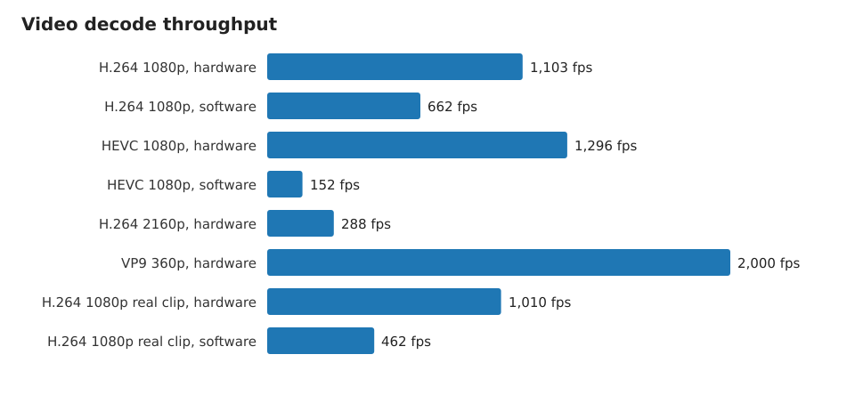
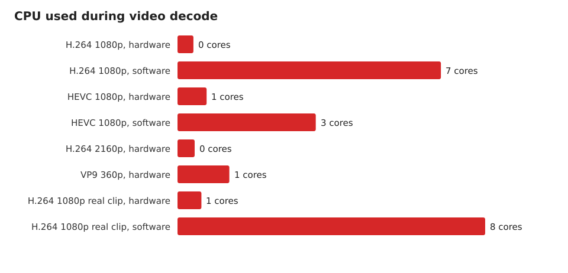
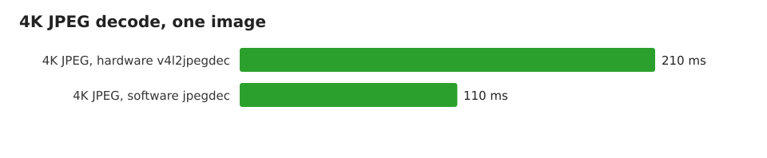

# Media and graphics

Video decode, image decode and GPU facts for the Lenovo LACM-MN101
(CIX Sky1 / CD8180). Raw data: [../media](../media).

## Official capabilities

From the public CIX documents:

| Document | Content |
| --- | --- |
| CIX-P1-CP8180-DS-Brief-EN Rev D | SoC features |
| CIX-P1-Technical Reference Manual | VPU, GPU and display chapters |
| CIX-P1-VPU 开发指导手册 | VPU driver and performance |
| CIX-P1-多媒体开发指导手册 | GStreamer, Codec2, codec matrix |
| CIX-P1-VAAPI 开发指导手册 | VA-API stack |
| CIX-P1-Linux GPU 开发使用手册 | GPU stack, Mesa Zink, AFBC |
| CIX-P1-CME开发指导手册 | Codec2 media engine |

The documents are vendor material. They are not copied into this repository.

### SoC

| Block | Capability |
| --- | --- |
| GPU | Arm Immortalis-G720 MC10, 10 cores, four 512 kB L2 caches |
| GPU API | OpenGL ES 3.2, Vulkan 1.3, OpenCL 3.0 |
| VPU decode | 8K@60, 8 bit and 10 bit |
| VPU encode | 8K@30 |
| ISP | 8K@15 recording, up to four cameras |
| Display | up to ten displays, 4K@120 each, HDCP 2.2/2.3 |
| NPU | up to 30 TOPS |

### Codec limits

| Codec | Decode | Encode | Maximum decode performance |
| --- | --- | --- | --- |
| AV1 | yes | no | 8192x8192, 8K@60, 400 Mbps |
| HEVC | yes | yes | 8192x8192, 8K@60, 480 Mbps |
| H.264 | yes | yes | 8192x8192, 8K@60, 480 Mbps |
| VP9 | yes | yes | 8192x8192, 8K@60, 480 Mbps |
| VP8 | yes | yes | 2048x2048 |
| MPEG-2 | yes | no | 4096x4096 |
| MPEG-4 | yes | no | 2048x2048 |
| H.263 | yes | no | 2048x2048 |
| JPEG, MJPEG | yes | yes | 32768x32768, 8K@30, 900 Mbps |

The VPU runs 16 streams of 1080p60 or 60 streams of 720p25 at the same time
for H.264, HEVC, AV1 and VP9. Encode performance is half of decode
performance.

## What the machine exposes

| Item | State |
| --- | --- |
| Kernel driver | `amvx`, four M2M nodes, /dev/video0 to /dev/video3 |
| Debug interface | /sys/kernel/debug/amvx |
| Decode formats | H.263, H.264, HEVC, MPEG-2, MPEG-4, VP8, VP9, AV1 |
| Output formats | NV12, NV21, YU12, and AFBC YUV420/422 8 and 10 bit |
| GStreamer | v4l2h264dec, v4l2h265dec, v4l2vp9dec, v4l2vp8dec, v4l2av1dec, v4l2mpeg4dec, v4l2mpeg2dec, v4l2h263dec, v4l2jpegdec |
| GStreamer encode | v4l2h264enc, v4l2h265enc, v4l2vp9enc, v4l2vp8enc, v4l2jpegenc |
| ffmpeg | v4l2m2m decoders for H.263, H.264, HEVC, MPEG-1, MPEG-2, MPEG-4, VC1, VP8, VP9 |
| GPU driver | `mali_kbase` DKMS 1.0.0, Vulkan 1.4.305, driver v1.r54p1 |
| OpenCL | 3.0, Mali-G720-Immortalis r0p0, 10 compute units |
| VA-API | not usable. The CIX user-space driver `linlondp_drv_video.so` is missing. |

The machine does not ship the CIX super resolution element `cixsr`, and it
does not ship the CIX VA-API driver. Both are in the vendor package set.

## Decode measurements

`ffmpeg` with `-c:v <decoder> -f null -`, median of three runs.
The synthetic clips come from `testsrc2`. The real clip is a 1080p H.264
sample, 300 frames.

| Clip | Decoder | Wall | CPU | fps | Cores |
| --- | --- | --- | --- | --- | --- |
| H.264 1080p60, 600 frames | hardware | 0.54 s | 0.22 s | 1,103 | 0.40 |
| H.264 1080p60, 600 frames | software | 0.91 s | 6.00 s | 662 | 6.61 |
| HEVC 1080p60, 600 frames | hardware | 0.46 s | 0.34 s | 1,296 | 0.73 |
| HEVC 1080p60, 600 frames | software | 3.94 s | 13.69 s | 152 | 3.47 |
| H.264 2160p30, 300 frames | hardware | 1.04 s | 0.45 s | 288 | 0.43 |
| VP9 360p30, 60 frames | hardware | 0.03 s | 0.04 s | 2,000 | 1.30 |
| H.264 1080p, real clip, 300 frames | hardware | 0.30 s | 0.18 s | 1,010 | 0.60 |
| H.264 1080p, real clip, 300 frames | software | 0.65 s | 5.01 s | 462 | 7.72 |

Hardware decode is 2.2 times faster than software decode on the real clip.
It uses 0.6 cores against 7.7 cores. On HEVC the gain is larger: 8.5 times
the throughput.

## GStreamer

Same 1080p60 clip, 600 frames.

| Element | Wall | CPU |
| --- | --- | --- |
| v4l2h264dec | 1.11 s | 104 percent |
| avdec_h264 | 1.07 s | 584 percent |
| v4l2h265dec | 0.78 s | 169 percent |

The GStreamer hardware path is slower than the ffmpeg hardware path on this
small clip, because of the pipeline overhead. It still uses far less CPU.

## Image decode

One 3840x2160 JPEG.

| Path | Wall | CPU | Images/s |
| --- | --- | --- | --- |
| v4l2jpegdec, hardware | 0.21 s | 90 percent | 4.8 |
| jpegdec, software | 0.11 s | 92 percent | 9.1 |

Software JPEG decode is faster for one image here. The hardware path has
fixed setup cost per pipeline start.

## Encode measurements

| Test | Wall | CPU |
| --- | --- | --- |
| H.264 1080p, 300 frames, v4l2h264enc | 1.32 s | 152 percent |
| JPEG 1080p, 30 images, v4l2jpegenc | 0.61 s | 112 percent |

From the clip generation step:

| Test | Wall |
| --- | --- |
| H.264 1080p60, 10 s, hardware encoder | 1.11 s |
| HEVC 1080p60, 10 s, hardware encoder | 1.36 s |
| H.264 2160p30, 10 s, hardware encoder | 2.05 s |
| JPEG 3840x2160, one image, hardware encoder | 0.13 s |

## Graphics

| Test | Result |
| --- | --- |
| Device | Mali-G720-Immortalis r0p0 |
| Vulkan | 1.4.305, driver v1.r54p1 |
| OpenCL | 3.0, 10 compute units |
| glmark2 ES 2.0, Wayland, off screen | 4,536 |

See [performance.md](performance.md) for the full graphics run.

## Notes and gaps

1. VA-API needs the CIX user-space driver. Without it, `vainfo` fails and
   `mpv --hwdec=vaapi` cannot work. Use the V4L2 path instead.
2. `v4l2jpegdec` hung once in ten runs. The same pipeline works alone.
   Keep a timeout around it.
3. VP9 decode worked through the ffmpeg `vp9_v4l2m2m` wrapper. The
   GStreamer test failed on the WebM demuxer link, so it is not counted.
4. VP8 decode is present in the kernel and in ffmpeg. The GStreamer test
   needs a `vp8parse` element, which this image does not have.
5. AV1 decode worked through `ivfparse ! av1parse ! v4l2av1dec`.
6. The NPU driver is blacklisted in this image, so the 30 TOPS NPU is not
   measured here.
