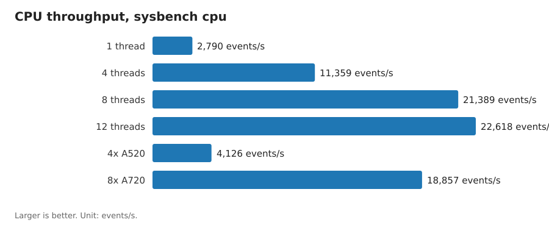
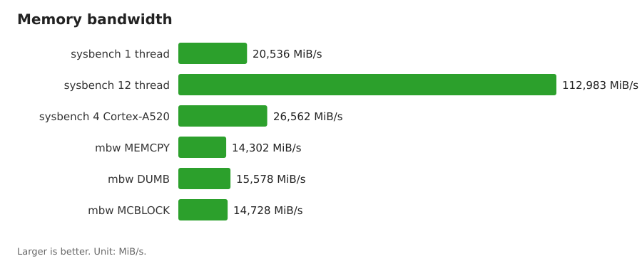
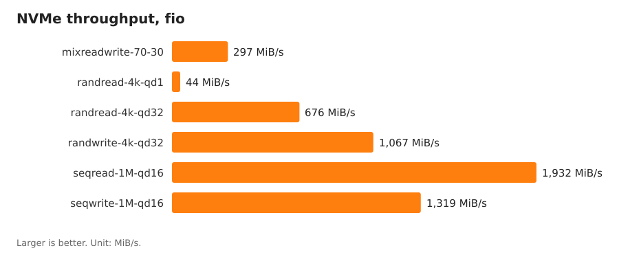
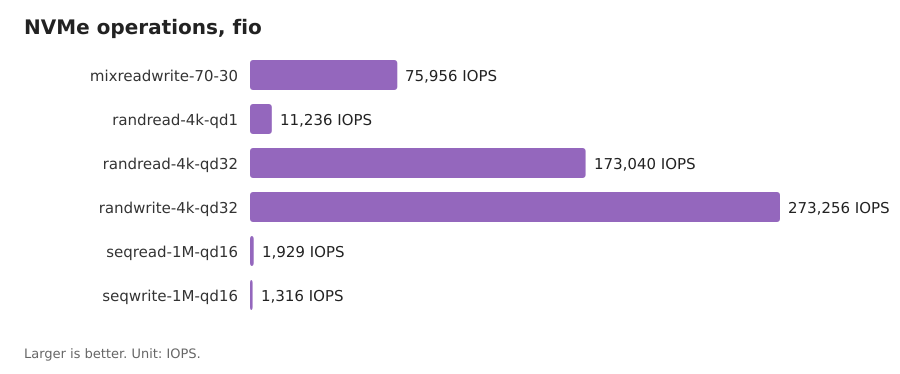
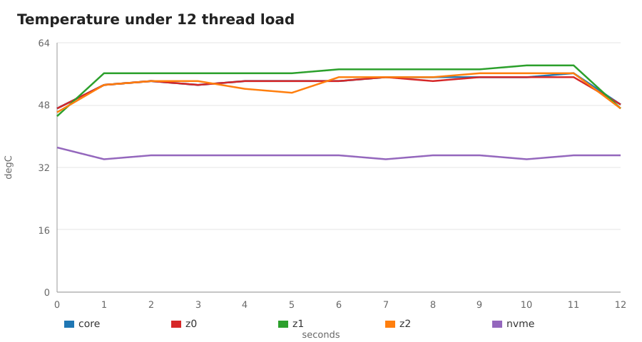

# Performance

Measurements from one Lenovo LACM-MN101, CIX Sky1 (CD8180), 8 GB LPDDR5,
AirDisk 256 GB NVMe. Kernel 7.0.0-38-cix, Ubuntu 26.04.

Raw logs: [../benchmarks/raw](../benchmarks/raw). Parsed data:
[../benchmarks/results](../benchmarks/results). Chart sources:
[../benchmarks/charts](../benchmarks/charts).

## Conditions

| Item | Value |
| --- | --- |
| CPU governor | schedutil, boost disabled |
| A720 clock under load | 2600 MHz, held for the full run |
| A520 clock under load | 1800 MHz, held for the full run |
| Idle temperature | 44 to 47 degC |
| NVMe temperature | 34 to 37 degC |
| Power profile | factory default, display attached |

## CPU

`sysbench cpu`, prime limit 10000, 15 s per run.

| Configuration | Events/s | Scale |
| --- | --- | --- |
| 1 thread | 2,790 | 1.00x |
| 4 threads | 11,359 | 4.07x |
| 8 threads | 21,389 | 7.67x |
| 12 threads | 22,618 | 8.11x |
| 4 Cortex-A520, pinned | 4,126 | 1.48x |
| 8 Cortex-A720, pinned | 18,857 | 6.76x |

Scale stops at 8.11x for 12 threads. The four A520 cores add little
throughput. Pinning the eight A720 cores gives 18,857 events/s, so the
general 12-thread run gains 20 percent from the small cores.

| Test | Result |
| --- | --- |
| sysbench threads, 12 threads | 10,457 events/s, mean latency 1.15 ms, p95 4.82 ms |
| 7-Zip, 1 thread | 5,071 MIPS |
| 7-Zip, 12 threads | 40,602 MIPS, 8.0x scaling |
| stress-ng cpu, 12 threads, 60 s | 128,309 operations, 2,137 operations/s |

## Memory

| Test | Result |
| --- | --- |
| sysbench memory, 1 thread, 1 MiB blocks | 20,536 MiB/s |
| sysbench memory, 12 threads | 112,983 MiB/s |
| sysbench memory, 4 Cortex-A520 | 26,562 MiB/s |
| mbw MEMCPY, 256 MiB | 14,302 MiB/s |
| mbw DUMB, 256 MiB | 15,578 MiB/s |
| mbw MCBLOCK, 256 MiB | 14,728 MiB/s |

The mbw values are the median of three runs. One earlier run measured
5,066 MiB/s for MEMCPY. Treat that run as an outlier.

## Storage

`fio` on the AirDisk 256 GB NVMe, direct I/O, on the /data partition.
Four jobs and 20 s per test, unless the table says otherwise.

| Test | IOPS | Throughput | Mean latency | p99 latency |
| --- | --- | --- | --- | --- |
| Sequential read, 1 MiB, QD16 | 1,929 | 1,932 MiB/s | 32.9 ms | 50.6 ms |
| Sequential write, 1 MiB, QD16 | 1,316 | 1,319 MiB/s | 48.1 ms | 79.2 ms |
| Random read, 4 KiB, QD32 | 173,040 | 676 MiB/s | 0.73 ms | 2.44 ms |
| Random write, 4 KiB, QD32 | 273,257 | 1,067 MiB/s | 0.46 ms | 1.86 ms |
| Random read, 4 KiB, QD1, one job | 11,236 | 43.9 MiB/s | 0.079 ms | 0.092 ms |
| Mixed 70/30, 4 KiB, QD32 | 75,956 read, 32,656 write | 297 + 128 MiB/s | 1.61 ms | 3.39 ms |

The link reports four lanes. Sequential speed stays under 2 GB/s, so the
link is not the limit. The queue depth 1 latency of 0.079 ms is low.

## Graphics

| Test | Result |
| --- | --- |
| Device | Mali-G720 Immortalis |
| Vulkan | 1.4.305, driver v1.r54p1 |
| glmark2 ES 2.0, Wayland, off screen | 4,536 |
| glmark2 ES 2.0, X11 | not available. The session refused authorisation. |

## Thermal behaviour

Load: `stress-ng --cpu 12` for 60 s. Samples every 5 s.

| Item | Value |
| --- | --- |
| Idle | 44 to 47 degC |
| Peak core sensor | 56 degC |
| Peak SoC zone | 58 degC |
| NVMe | 34 to 37 degC |
| Frequency | 2600 MHz A720, 1800 MHz A520, no drop |
| After the run | 47 to 48 degC |

No thermal throttling in the 60 s window. Each cluster held its maximum
frequency.

## Notes

1. The X11 GPU test needs an authorised session. Run the Wayland test
   instead, or export the session cookie.
2. The firmware ships with `boost` disabled. `stress-ng` reports this.
   A run with boost enabled would give different CPU numbers.
3. One machine only. The values are not a population sample.
4. Compare numbers only against the same tool and the same options.
